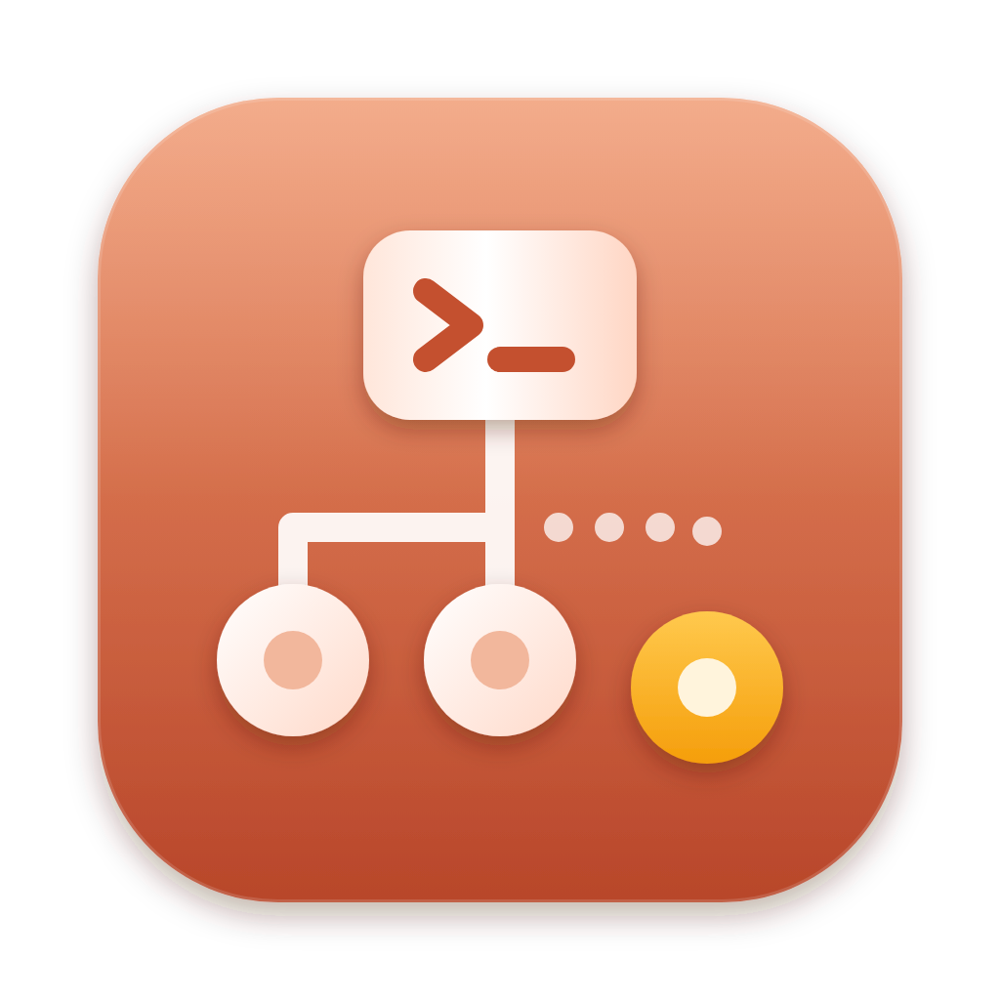
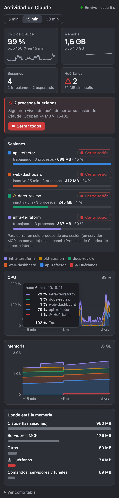

<p align="center">
  
</p>

<h1 align="center">Claude Processes</h1>

<p align="center">
  <strong>An activity monitor for Claude Code, built into Orca.</strong><br>
  Sessions · MCP servers · Background commands · Orphaned processes · Leftover worktrees
</p>

<p align="center">
  
  
  <a href="LICENSE"></a>
</p>

<p align="center">
  
</p>

## Why Claude Processes

Every Claude Code session starts processes of its own: MCP servers, the shells
behind the Bash tool, and the dev servers and tunnels it launches for you. Most
of them end with the session. Some don't. A crashed session, a `nohup` from a
background command or a forgotten tunnel keeps holding memory and ports long
after anyone needs it. With a few sessions open, Activity Monitor can't tell
you which `node` belongs to which conversation.

Sessions leave folders behind too. `claude --worktree`, the EnterWorktree tool,
isolated subagents and every `git worktree add` Claude runs for a task open a
Git worktree, and nothing closes it when the session ends. After a few weeks a
repository has dozens of them, each with its own `node_modules`.

Claude Processes groups every process under the session that started it,
names each session, finds what outlived its session and tells you what is safe
to close. It does the same for worktrees: it finds every one in the
repositories Claude worked in and proposes closing the ones nobody has touched
in a while. It is careful about it: it asks before closing anything, checks
each process or worktree again right before acting on it, and never touches a
process that isn't Claude's or a worktree with work that would be lost.

## Features

### Every session at a glance
- **Sessions by name**, as Claude Code names them, with their folder, their
  terminal and the memory they hold together with everything they started.
- **Real status**: *working*, or *idle* and for how long. It comes from Claude
  Code itself and is not guessed from CPU usage.
- **The full process tree** of each session: MCP servers, Bash commands and
  what they run, dev servers with their ports, tunnels, `caffeinate` and nested
  `claude` runs.
- Sessions running in any terminal (Orca, Ghostty, Terminal, iTerm2, VS Code)
  show up, not only Orca's.

### Activity over time
- **A second panel, Claude Activity**, in the spirit of Activity Monitor's
  graphs: CPU and memory over the last 5, 15 or 30 minutes, stacked by session
  and sampled every 5 seconds.
- **Real CPU usage**, measured from each process's CPU time between samples.
  It is not the smoothed average `ps` reports.
- **A crosshair and tooltip** that list every session at that moment. Arrow
  keys walk the timeline too.
- **Where the memory is**: Claude itself, MCP servers, commands and servers,
  browsers and orphans, ranked.
- **Each session keeps its color** while it is on screen, and orphans are
  always red with ⚠. A table view carries every value without relying on color.
- **Close from the same view**, like Activity Monitor's stop button: every
  session has a *Close session* button, and certain orphans get a *Close all*
  notice. Both ask the same confirmation as the main panel, right where you
  clicked.
- **Close only some processes and keep the session**: expand a session, tick
  the processes you want gone (or *Select unneeded* to tick the ones nothing
  uses), and close just those. Their children go with them; the
  session stays open.

### Find what outlived its session
- **Orphans**: processes still running after their session ended, with the
  session they came from and when it ended.
- **Detached processes**: things a live session started that are no longer
  tied to it, such as a `nohup … &` from Bash. They will survive when you close
  the session.
- **Certain or probable**: certain when the plugin saw the process start under
  a session, probable when it only looks like something Claude starts, such as
  an MCP server with no owner.
- A **desktop notification** the first time something outlives its session.

### Worktrees left open
- **Every worktree** of the repositories Claude Code worked in, in a
  *Worktrees* tab: the ones in `.claude/worktrees/`, the ones subagents
  created, and any other `git worktree add`, with its branch, its size on disk
  and how long it has been idle.
- **Idle time that means something**: the last commit or checkout, the last
  uncommitted edit, or the last Claude conversation held in it, whichever is
  latest.
- **Close**: no activity for longer than you set (7 days by default) and
  nothing to lose. No uncommitted changes, and the branch stays.
- **Review**: idle, but closing it would lose something:
  - uncommitted or untracked files;
  - commits on a detached HEAD that no branch reaches.
- **Keep**: a live session is working in it, a subagent of a live session
  holds it, or it had activity recently.
- **A notice with one button** for the ones marked *Close*, with the disk space
  they free. Anything else you pick yourself, row by row.
- **Never offered**: a repository's main folder, a worktree you locked with
  `git worktree lock`, and Orca's own workspaces, which you close from Orca.

### A verdict for every process
- **Close**: an orphan nobody is using.
- **Review**:
  - a session idle for longer than you set;
  - a command or server running in the background for over an hour;
  - a detached process;
  - an MCP server of uncertain origin.
- **Keep**: what a live session is using, such as its MCP servers,
  `caffeinate` and commands in progress.
- Every verdict comes with its reason. Selecting a row shows its full command
  line.

### Close with care
- **The confirmation appears where you clicked**, inside the session card or in
  place of the orphan alert. It lists what will close, the memory it frees and
  the ports it releases.
- **It spells out the consequences**:
  - a busy session loses the task in progress;
  - closing an MCP server takes its tools away from the session;
  - a closed session can be resumed with the `claude --resume <id>` it shows.
- **SIGTERM first**, so sessions shut down their own MCP servers. SIGKILL only
  if something doesn't respond, and only when you ask for it.
- **Checked again before every signal**: the worker takes a fresh snapshot
  and only signals processes that are still there with the same start time, so
  a reused PID is never hit. Processes of other users and anything not tied to
  Claude are never offered.
- **Worktrees go through `git worktree remove`**, which deletes the folder and
  keeps the branch and its commits. The confirmation says what is deleted
  (ignored files such as `node_modules` and `.env` go with the folder) and
  names every worktree whose uncommitted changes would be discarded.
- **Checked again before every removal**: the worker reads the worktree again
  and leaves it alone if it has new commits, a session started working in it,
  or it has changes the confirmation didn't warn about.

### Always in sight
- A **status bar item**, `Claude 5 · 2 orphans · 3 worktrees`, that turns
  amber when there are orphans and red when they hold ports. The worktree count
  is the ones proposed for closing. Click it to check now.
- Three **command palette** entries: check now, close every certain orphan, and
  close every inactive worktree with nothing to lose.
- A **desktop notification** the first time a worktree goes inactive.

### In your language
- **English and Spanish.** The panels, the status bar and the notifications
  follow Orca's interface language: Spanish when Orca is in Spanish, English
  for any other language.
- **Your choice wins**: the *Language* setting can pin English or Spanish
  regardless of Orca's language.

## Install

Requires **Orca 1.4.248 or later on macOS or Linux**, with plugins turned on
(Settings → Plugins → *Turn on plugins*). On Linux it needs `ps` from procps,
which desktop distributions install by default; it reads ports and folders
from `/proc`, so `lsof` isn't needed. The Worktrees tab needs `git` on the
`PATH`.

1. **Request the install.** The plugin runs code, so Orca asks for your approval
   first. It prints the access the plugin requests and a fingerprint:

   ```sh
   orca plugin install naitsric/orca-claude-procesos
   ```

2. **Approve it** with that fingerprint:

   ```sh
   orca plugin install naitsric/orca-claude-procesos --approve ap1-…
   ```

3. **Open it** from Orca's right sidebar: **Claude Processes** has the
   sessions and their processes, **Claude Activity** the graphs. Or from the
   terminal:

   ```sh
   orca plugin open naitsric.claude-procesos --panel procesos
   orca plugin open naitsric.claude-procesos --panel actividad
   ```

The `orca` CLI ships inside the app. If your shell can't find it on macOS, use
`/Applications/Orca.app/Contents/Resources/bin/orca` or add an alias for it.

**Update** with `orca plugin update naitsric.claude-procesos`. It asks for
approval again only if the requested access changes. **Uninstall** with
`orca plugin uninstall naitsric.claude-procesos`.

### Permissions

| Access | Why |
| --- | --- |
| Run code in Node.js as your user (`trusted-worker`) | List processes with `ps` (plus `lsof` on macOS and `/proc` on Linux), read `~/.claude/sessions/`, and signal the processes you choose to close. Read `~/.claude.json` for the folders Claude Code was opened in, run `git` and `du` in those repositories, and remove the worktrees you choose to close. |
| `storage:own` | Remember which processes started under each session. That record is how it recognizes orphans. Also which inactive worktrees it already told you about. |
| `settings:own` | Read its own settings. |
| `notifications:show` | Tell you when something outlives its session. |

The plugin makes no network requests.

## Settings

In Settings → Plugins → Claude Processes:

| Setting | Default | |
| --- | --- | --- |
| Language | Same as Orca | English or Spanish. *Same as Orca* uses Orca's interface language, and English if it is neither. |
| Check interval | 15 s | From 5 to 300 seconds. |
| Long session threshold | 12 h | A session idle for longer than this is marked for review. |
| Notify about orphans | On | A desktop notification the first time a process outlives its session. |
| Days before a worktree counts as inactive | 7 | From 1 to 365. Past this with no activity, a worktree is proposed for closing if it has nothing to lose, and marked for review otherwise. |
| Notify about inactive worktrees | On | A desktop notification the first time a worktree goes inactive with nothing to lose. |

## How it works

**Sessions.** A process belongs to a session when it descends from a `claude`
process. The name, conversation ID and status come from
`~/.claude/sessions/<pid>.json`, which Claude Code keeps up to date. On
versions that don't write that file, the panel uses the folder and CPU usage
instead.

**Orphans.** A process doesn't say which session started it, so the worker
checks every few seconds and keeps a record of what it saw:
- which processes descended from each session;
- which process groups each session and each Bash shell led;
- when each session ended (kept for seven days).

When a process's parent dies, it is adopted by `launchd` on macOS, and on
Linux by `init` or by the `systemd --user` of the desktop session. An adopted
process is a certain orphan when it matches that record, or when it is a Bash
tool shell, which carries the
`~/.claude/shell-snapshots` marker. Orphans whose session ended before the
plugin was installed can only be recognized by that marker; MCP servers among
them show up as probable.

**Graphs.** Every 5 seconds the worker takes a light sample with `ps` alone
(on Linux, plus `/proc/<pid>/stat`, since `ps` there counts CPU time in whole
seconds). It sums each session's memory and the CPU time its processes used
since the previous sample. It keeps 30 minutes of samples and saves them once a minute,
so the graphs survive a restart. Gaps in sampling show as gaps, never as
interpolated lines. Orca stores at most 256 KiB per value, and half an hour of
samples passes that with more than about ten sessions open; then the saved copy
keeps the whole half hour at a coarser step (one averaged sample every 10
seconds, 20, 40…), and the graphs you have open stay at 5 seconds.

**Worktrees.** Every ten minutes, and when you open the panel or press *Check
now*, the worker looks for repositories: the folders Claude Code was opened in
(`~/.claude.json`) and the ones its sessions work in. A folder that isn't a
repository counts for the repositories directly inside it that have a
`.claude/worktrees`. In each repository it runs `git worktree list`, and in
each linked worktree a `git status` that takes no lock, so it never gets in the
way of a session working there. A worktree's last activity is the newest of:
its `HEAD`, its index, its uncommitted files, and the Claude conversations
held in it (`~/.claude/projects/`). A subagent's worktree carries a Git lock
naming the session that started it; once that session is gone the lock no
longer protects anything, and the plugin lifts it to close the worktree. Sizes
come from `du`, measured one at a time in the background.

**Safety.** Every close goes through the worker. It takes a new snapshot and
signals a process only if it is still there, belongs to your user and has the
same start time as the one you chose. A worktree is removed only if a fresh
reading still shows it at the same commit, with no session in it and no changes
you weren't warned about; without that warning the worker never passes
`--force`, so Git itself refuses to delete uncommitted work.

## Roadmap

- Jump from a session to its Orca terminal
- Delete the branch of a closed worktree when it is already merged

## Contributing

The plugin is plain TypeScript that Orca loads without a build step. See
[CONTRIBUTING.md](CONTRIBUTING.md) to load it from a clone, run the tests and
find your way around the code.

## License

[MIT](LICENSE)

---

<sub>Claude and Claude Code are trademarks of Anthropic. Orca is developed by Stably AI. Claude Processes is an independent project and is not affiliated with or endorsed by either.</sub>
